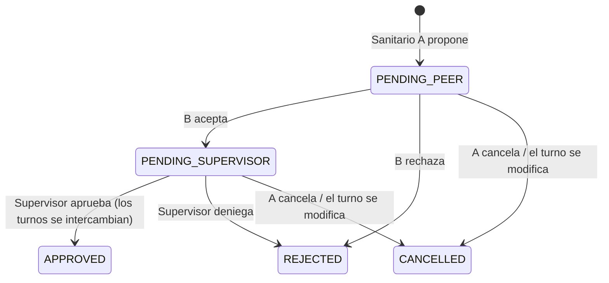

# Gestor de Turnos 🏥

Aplicación web para que el **personal sanitario** y su **supervisor/a de planta** gestionen los turnos sin perder información: cada sanitario consulta su calendario, propone intercambios a compañeros y la supervisión los aprueba con un clic. El cuadrante se actualiza solo y todos reciben un aviso.

> Proyecto de portfolio · React + Express + Prisma

## El problema

En muchas plantas hospitalarias los turnos se gestionan con hojas impresas, grupos de WhatsApp y conversaciones de pasillo. El resultado:

- Nadie tiene claro cuál es la versión buena del cuadrante.
- Los intercambios entre compañeros se pierden o la supervisión no se entera.
- Se cuelan errores, como que alguien acabe con dos turnos el mismo día.

## Funcionalidades

| Sanitario | Supervisor/a de planta |
|---|---|
| Calendario mensual con sus turnos y el próximo turno destacado | Cuadrante de toda la planta (personal × días) |
| Ver el cuadrante completo de su planta | Asignar, cambiar o quitar turnos con un clic |
| Proponer un **intercambio** o **ceder** un turno a un compañero | Aprobar o denegar los intercambios aceptados |
| Aceptar o rechazar propuestas recibidas | Ver la **cobertura** por turno y día (marca en rojo los huecos) |
| Avisos de cada cambio que le afecta | Dar de alta personal en su planta |
| Marcar **vacaciones** (23 días/año) y **asuntos propios** (6 días/año) en su calendario | Ver las ausencias en el cuadrante y recibir aviso de cada una |

### Flujo de un intercambio



### Reglas de negocio

- Nadie puede tener dos turnos el mismo día (restricción única en la base de datos + validación previa).
- Solo puedes ofrecer **tus** turnos, y solo turnos futuros.
- Solo puedes hacer intercambios con compañeros de **tu planta**.
- Los conflictos se comprueban al crear la propuesta y **otra vez al aprobarla**, dentro de una transacción, porque el cuadrante puede haber cambiado entre medias.
- Si la supervisión modifica un turno, se cancelan los intercambios pendientes que lo incluyen.
- Al aprobar un intercambio, se cancelan las demás propuestas pendientes sobre esos mismos turnos.
- Cada sanitario tiene 23 días de vacaciones y 6 de asuntos propios por año natural. Si pide un día en el que tenía turno, el turno se libera y la supervisión recibe un aviso para cubrirlo.
- No se puede asignar ni recibir por intercambio un turno en un día de vacaciones o asunto propio.

## Stack

- **Frontend:** React 19, React Router, Vite y CSS propio (diseño pensado para móvil primero)
- **Backend:** Node.js, Express 5, Zod (validación) y JWT + bcrypt (autenticación)
- **Base de datos:** Prisma ORM con SQLite (migrable a PostgreSQL cambiando el `provider`)
- **Tests:** Vitest + Supertest (tests de integración de la API)

## Puesta en marcha

Requisitos: Node.js 20 o superior.

```bash
npm run install:all   # instala dependencias de backend y frontend
npm run setup         # crea backend/.env, la base de datos y los datos de demo

# en dos terminales:
npm run dev:backend   # API en http://localhost:3000
npm run dev:frontend  # web en http://localhost:5173
```

> Antes de usarla en serio, cambia `JWT_SECRET` en `backend/.env` por una cadena aleatoria.

### Cuentas de demo

Contraseña de todas: `turnos123`. En la pantalla de login también hay botones de acceso rápido.

| Usuario | Rol |
|---|---|
| supervisora@hospital.test | Supervisora de planta |
| lucia@hospital.test, marcos@hospital.test, ana@hospital.test, javier@hospital.test | Enfermería |
| carmen@hospital.test, david@hospital.test | TCAE |

Para volver a los datos iniciales: `npm run db:seed --prefix backend`.

### Tests

```bash
npm test
```

Cubren la autenticación, los permisos y las reglas de intercambio, incluido el caso límite de cambiar dos turnos del mismo día.

## Estructura

```
backend/
  prisma/schema.prisma     modelo de datos (Unit, User, Shift, SwapRequest, Notification)
  prisma/seed.js           datos de demo con rotación M-M-T-T-N-N-L-L
  src/app.js               configuración de Express y rutas
  src/routes/              endpoints REST (auth, users, shifts, swaps, notifications)
  src/services/            lógica de negocio de los intercambios
  tests/                   tests de integración
frontend/
  src/pages/               Mis turnos, Cuadrante, Intercambios, Avisos, Login
  src/components/          Layout, Modal, SwapModal...
  src/lib/                 cliente de la API, autenticación y utilidades de fechas
```

## API

| Método | Ruta | Quién |
|---|---|---|
| POST | `/api/auth/login` | público |
| GET | `/api/auth/me` | autenticado |
| GET / POST | `/api/users` | todos / supervisor |
| GET | `/api/shifts?from&to&userId` | autenticado (su planta) |
| POST / PATCH / DELETE | `/api/shifts/:id` | supervisor |
| GET / POST | `/api/swaps` | autenticado |
| POST | `/api/swaps/:id/accept` · `reject` | compañero destinatario |
| POST | `/api/swaps/:id/cancel` | quien lo propuso |
| POST | `/api/swaps/:id/approve` · `deny` | supervisor |
| GET | `/api/notifications` · POST `/:id/read` · `/read-all` | autenticado |
| GET / POST | `/api/absences?from&to&userId` | autenticado (su planta / sus días) |
| GET | `/api/absences/balance?year` | autenticado (su saldo) |
| DELETE | `/api/absences/:id` | quien pidió el día |

## Próximos pasos

- [ ] Despliegue (Render/Railway + PostgreSQL en Neon)
- [ ] Notificaciones push o por email
- [x] Solicitud de días libres y vacaciones
- [ ] Bolsa de turnos: publicar un turno para que lo coja cualquier compañero
- [ ] Reglas de descanso mínimo entre turnos (por ejemplo, no encadenar noche y mañana)
- [ ] Exportar el cuadrante a PDF o iCal
